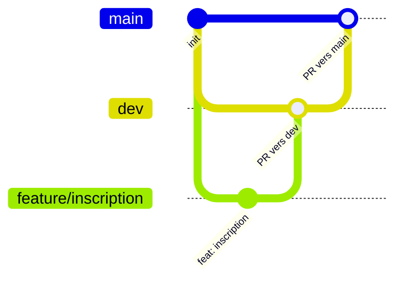

# EventHub

## Conventions de commit

Application

Ce projet suit [Conventional Commits](https://www.conventionalcommits.org/fr/v1.0.0/).

Format : `<type>(<portée optionnelle>): <description>`

| Type     | Usage                   |
| -------- | ----------------------- |
| feat     | nouvelle fonctionnalité |
| fix      | correction de bug       |
| docs     | documentation           |
| style    | mise en forme           |
| refactor | restructuration du code |
| perf     | performances            |
| test     | tests                   |
| build    | dépendances, build      |
| ci       | intégration continue    |
| chore    | maintenance             |
| revert   | annulation d'un commit  |

Exemple : `feat(events): ajoute la création d'un événement`

## Workflow Git

| Branche                      | Rôle               | Règles                                                             |
| ---------------------------- | ------------------ | ------------------------------------------------------------------ |
| `main`                       | production         | protégée, modifiée uniquement par PR depuis `dev`                  |
| `dev`                        | intégration        | protégée, modifiée uniquement par PR depuis une branche éphémère   |
| `feature/<nom>`, `fix/<nom>` | branches éphémères | créées depuis `dev`, fusionnées dans `dev` par PR, puis supprimées |
